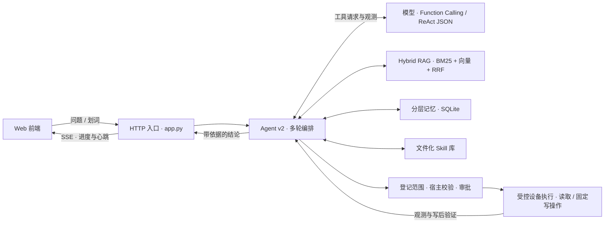

# Agent Troubleshooting Assistant

面向多节点高可用 Linux 网络拓扑的自主排障 Agent Web 应用，能针对主备、隧道和业务路径问题分步取证，并给出带依据的判断。

**典型问题**：“远端能 ping 通，业务为什么还是不通？”Agent 会结合主备角色、VIP、服务和路由状态缩小排查范围，在结论里标出已经观察到的状态和仍待验证的链路。

## 核心亮点

| 能力 | 项目实现 |
| --- | --- |
| 自主多轮工具编排 | 模型通过 Function Calling 分步选择检查项，宿主校验参数并将观测送回模型。接口拒绝工具协议时，自动降级到 ReAct JSON。 |
| 轻量 Hybrid RAG | BM25 和本地字符 n-gram 向量各自排序，再用 RRF 融合。公开版 24 条查询的离线消融中，Recall@5 从纯向量的 **0.521** 提升到 **0.667**，BM25 单独为 **0.417**。 |
| 分级权限与写后验证 | 只读巡检按登记范围取证，批准执行受任务和设备许可约束，自动修复仅在维护窗口内处理满足条件的固定动作。写后重新采样服务和 VIP，形成 Verify-and-Loop，并记录验证结果。 |
| 分层记忆与自主 Skill | 用近期对话、滚动摘要和跨会话经验维持上下文。Agent 可检索文件化 Skill，并在具备权限时沉淀可复用的排障步骤。 |
| Web 交互与流式容错 | 支持并发对话和划词知识库检索。模型输出截断时尝试独立收尾，等待期间用 SSE 心跳保持连接。 |

## 系统架构



## 目录导航

```text
.
├── app.py                # HTTP 服务、会话、SSE
├── agent_v2.py            # 自主工具循环、协议降级、结论收尾
├── qa.py                  # 知识检索入口
├── hybrid_retrieval.py    # 本地向量排序和 RRF 融合
├── agent_memory.py        # SQLite 会话记忆与共享经验
├── device_tools.py        # 受控设备工具和参数边界
├── repair_control.py      # 固定修复动作与写后验证
├── web/                   # 聊天界面、证据展示与划词交互
├── tests/                 # Python 回归测试及共享夹具
├── docs/                  # 公开拓扑、运维知识与诊断手册
├── scripts/               # 离线演示、评测与前端检查
├── agent_skills/          # Skill 索引模板与运行时文件目录
├── evaluation/            # 评测实现与合成场景
├── planning/              # 知识来源、案例及覆盖配置
├── deploy/                # 公共部署入口
└── migration/             # 历史数据迁移协议
```

## 5 分钟本地启动

需要 Python 3.8 或更新版本。离线演示、回放和评测使用 Python 标准库与合成数据，无需 API Key 或设备连接。

```sh
git clone https://github.com/Mdload/agent-troubleshooting-assistant.git
cd agent-troubleshooting-assistant
python -B scripts/preview_offline.py --scenario owner_stopped
```

打开 [离线演示](http://127.0.0.1:17871/)，提问“远端业务不通，先检查主备的服务和 VIP”，按页面提示确认只读巡检。在终端输入 `stop` 退出。常规服务入口是 `python -B app.py`，默认监听 [本地 Web 界面](http://127.0.0.1:17865/)，实时模型问答需要模型配置。

## 离线评测

```sh
python -B scripts/eval_agent_v2.py
python -B scripts/eval_hybrid_rag.py
python -B scripts/replay_offline.py --output artifacts/replay.json
python -B -m unittest tests.test_agent_v2 tests.test_retrieval_regression tests.test_device_probe tests.test_selection_explain
```

Agent 评测覆盖 19 个场景。四场景回放输出工具顺序、合成观测、结论和审计记录，重复运行时请使用新的输出文件名。离线评测衡量宿主控制流、权限和检索表现，真实模型答复质量及端到端网络状态需在实际环境中单独验证。

可用 `python -B -m unittest discover -s tests` 发现并运行回归套件，也可从根目录直接运行单个文件，例如 `python -B tests/test_device_probe.py`。
