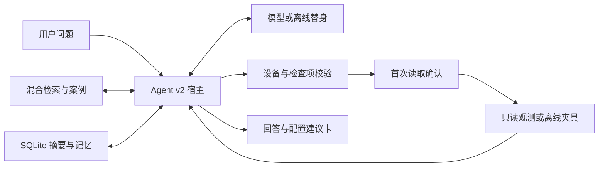

# Agent Troubleshooting Assistant

一个用 Python 标准库实现的网络排障助手。它用混合检索查找网络机制和案例，由宿主校验工具请求，并将服务、接口、日志和路由观测纳入回答。

## v0.10.11

- Hybrid RAG 融合 BM25 与向量排序，划词追问可以引用相关知识。
- 六个登记节点覆盖局端、远端及 Router1/2。Agent v2 在用户首次确认后执行只读巡检和定向探查，变更请求生成建议卡。
- 支持多对话并发、分层记忆和共享 Skill 的检索与沉淀。聊天界面折叠执行步骤并提供可复制的手动命令。
- 模型输出截断时尝试独立收尾，SSE 等待期间发送保活事件。

公开版使用文档专用设备地址、匿名知识和合成观测，附带空 Skill 库模板。

## 本地复现

需要 Python 3.8 或更新版本。以下命令无需安装 Python 依赖、配置 API Key 或连接设备。

```sh
python -B scripts/eval_agent_v2.py
python -B scripts/eval_hybrid_rag.py
python -B scripts/replay_offline.py --output artifacts/replay.json
```

Agent v2 评测包含 19 个场景，覆盖设备确认、配置建议卡、连续追问、记忆、检索、工具失败和结论收尾。Hybrid RAG 评测用 24 条查询比较 BM25、向量与混合排序。四场景回放使用确定性规划器，预期输出 `scenarios=4`、`engineering_assertions_passed=4`、`model_api_calls=0` 和 `live_device_reads=0`。报告记录工具顺序、合成观测、回答和审计。重复回放时使用新的输出文件名。

运行 `python -B app.py`，在浏览器打开本地页面。模型对话需要配置受支持的模型。 [本地 Web 界面](http://127.0.0.1:17865/)

## 处理流程



| 模块 | 职责 |
| --- | --- |
| [app.py](app.py) · [web/](web/) | HTTP 入口、账号和会话，以及聊天界面 |
| [agent_v2.py](agent_v2.py) | 工具调用循环、设备确认及配置建议卡 |
| [agent_memory.py](agent_memory.py) | SQLite 会话记忆、滚动摘要和共享经验 |
| [qa.py](qa.py) · [knowledge_modules.py](knowledge_modules.py) | 混合检索、模块知识手册与来源索引 |
| [device_registry.py](device_registry.py) · [device_tools.py](device_tools.py) | 登记设备及检查项，校验只读工具范围 |
| [unified_chat.py](unified_chat.py) · [lab_workflow.py](lab_workflow.py) | 兼容任务和文本材料的诊断编排 |
| [evaluation/remote_replay.py](evaluation/remote_replay.py) | 四个确定性合成诊断场景 |

## 核心演示场景

从“远端能 ping 通，但业务为什么不通？”出发，结合角色、VIP、Croc 服务和路由逐层分析。设备的管理可达性、隧道探测和端到端业务收发分别需要证据。

| 场景 | 验证点 |
| --- | --- |
| R01 · 持有 VIP，服务运行 | 继续检查路由，保留端到端业务状态未知 |
| R02 · 持有 VIP，服务停止 | 引用两项观测指出不一致，保留根因待查 |
| R03 · 备机无 VIP，服务停止 | 结合主备分工解释现象，保留接管能力待验收 |
| R04 · 读取超时 | 停止后续读取，报告状态未知 |

离线结果验证宿主控制流、权限和证据处理。模型答复准确率与真实链路效果需要独立验收。
