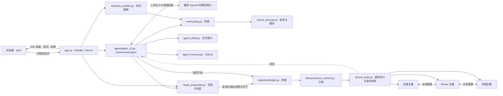
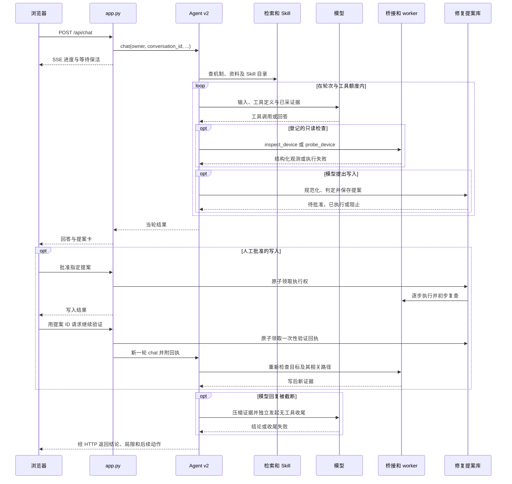

# Agent Troubleshooting Assistant

面向三层六节点高可用 Linux 网络的排障助手，当前工作版本为 **v0.10.17**。

它把自然语言问题转成有范围的检查计划，将设备观测、参考资料和待验证假设组织成可以复查的结论。
公开版提供脱敏拓扑、合成评测和本地演练。仓库内的地址与机器身份用于说明数据形状和回归测试。

## 1. 项目定位

三层业务路径由三对节点组成。每对都有自己的状态，任意单点正常都无法证明整条路径恢复。

| 层 | 节点 | 排查时关心什么 |
| --- | --- | --- |
| 远端接入 | 远端主机、远端备机 | 接入链路、选主、当前业务地址和隧道端点 |
| Router 转发 | Router1、Router2 | 转发开关、策略路由、业务出口与 NAT |
| 局端接收 | 局端主机、局端备机 | 当前 VIP 持有者、接收服务和隧道内业务 |

业务路径可双向验证。管理连接进入登记节点的固定地址，VIP 用于解释当前业务角色。
例如“远端能 ping 通，业务仍超时”可能涉及管理通路、内层隧道或应用服务中的任一层。
首先要问 ping 的源和目的，再根据选路、服务和地址证据决定接下来查哪里。

固定脚本擅长重复采同一组指标，复杂症状则需要根据上一轮结果改变下一步。
语言模型擅长理解这种自然语言线索，状态却需要实际工具采集，写操作也必须由程序裁决。
这里让模型选择检查顺序，让宿主程序约束可选动作、执行条件和结果的证据范围。

阅读路线从浏览器请求开始。先走通一轮只读检查，再理解批准、写后复查和跨轮记忆。

## 2. 系统架构



代码从 HTTP 入口接收浏览器上下文，由 Agent 持有本轮计划、工具结果和终止条件。
检索回答“有哪些机制值得检查”。设备工具回答“目前观察到了什么”。审批库决定“这次写操作能否执行”。

桥接和设备 worker 是两个进程边界。公开版的离线入口也保留浏览器和编排过程，并将外部模型与设备调用换成测试替身。

## 3. 从一次故障描述走到结论

下面以“远端管理地址可达，局端却收不到业务”为例，沿真实代码路径追踪。
序列中的设备结果取决于每轮观测，离线可以用后文命令复现典型交互。



### 3.1 浏览器、HTTP 与运行实例

1. [web/index.html](web/index.html) 的 `requestChat()` 提交问题、会话 ID、用于模型的历史和防跨站请求令牌。
   同一个入口也承载后续携带 `verify_proposal_id` 的验证请求。
2. [app.py](app.py) 的 `Handler.do_POST()` 检查请求与账号上下文，区分正常聊天与验证接续。
   需要模型的入口先领取进程级并发槽，槽位耗尽时返回忙碌响应。
   验证接续从服务端读回执，并核对归属与会话。
3. `Server.get_agent_v2()` 注入模型配置、内存库、读取工具和可选修复执行器。
   这层依赖注入让评测替换模型、探针与存储位置，同时继续执行真实编排代码。
4. `Handler.send_agent_chat()` 建立 SSE，启动后台 Agent 工作并转发进度。
   等待循环每五秒检查一次后台是否完成，仍在运行时发送心跳。

### 3.2 决定查什么以及怎样读取

5. [agent/agent_v2.py](agent/agent_v2.py) 的 `AutonomousAgent.chat()` 装配会话消息、有关历史和本轮能用的工具。
   `_run_search_knowledge()` 进入 [retrieval/qa.py](retrieval/qa.py) 的 `retrieve()`。
6. [retrieval/hybrid_retrieval.py](retrieval/hybrid_retrieval.py) 提供本地向量排序和 RRF。
   [agent/agent_skills.py](agent/agent_skills.py) 的 `render_index_summary()` 提供可按需展开的 Skill 目录。
7. `_call_llm()` 发出下一轮请求。若返回多个固定设备巡检，`_round_tools()` 组织可以合批的读取。
   例如分别查看局端的服务状态、远端的业务 VIP，再检查接收侧的隧道接口。
8. [devices/diagnostic_web.py](devices/diagnostic_web.py) 的 `remote_probe()` 和 `remote_probe_device()` 衔接 Web 与工具传输。
   [migration/web.py](migration/web.py) 把读写执行器接到桥接传输。
   [migration/bridge.py](migration/bridge.py) 的 `request_worker()` 发送限定结构的本地帧，桥接进程用 `call_remote()` 中转。
9. [devices/device_worker.py](devices/device_worker.py) 的 `dispatch()` 在设备侧再次校验请求。
   [devices/device_tools.py](devices/device_tools.py) 的 `probe()`、`probe_device()` 执行对应读取并返回结果。
   工具超时、身份未确认和工具读取成功是不同结果，后续推理应保留这一区别。

### 3.3 从提案到收尾

10. 若新证据提示需要写入，[agent/repair_proposals.py](agent/repair_proposals.py) 的 `normalized_steps()` 整理设备、动作和目标。
    例如只有故障设备和服务状态足以支持改变时，才会提出受控服务动作。
11. 策略允许时调用 `RepairProposals.execute()`，经桥接和 worker 执行，并对涉及的服务或路由做初步复查。
    等待批准的提案先返回卡片，用户可拒绝或批准。
12. 批准完成后，浏览器可以发起验证请求，服务端用 `claim_verification()` 领取绑定于该会话的回执。
    Agent 依据回执限制验证范围，以写入后的新观测继续推理。
13. 若模型回了 `finish_reason=length`，Agent 按现有证据尝试独立收尾。
    最终回答经 SSE 返回，浏览器渲染结论、依据以及仍未完成的检查。

## 4. 五个核心机制

### 4.1 工具轮次、并发巡检与截断恢复

Function Calling 给模型一组结构化工具。
典型输入包含工具名和 JSON 参数，典型输出包含经过程序采集和压缩的观测。
模型可以依据每轮结果改变下轮检查项，宿主始终保留对参数和可执行范围的裁决。

在 [agent/agent_v2.py](agent/agent_v2.py) 从 `default_llm_client()` 和 `_call_llm()` 开始读。
接口拒绝原生工具协议时，代码可改用 ReAct JSON，`_parse_fallback_tool_calls()` 负责解析回退格式。
两种协议产出的检查请求最终走同一套规则，因此回退保留工具边界。

`_round_tools()` 对本轮可并行的固定只读巡检使用线程池。
并发数受 `MAX_PARALLEL_READS` 约束，桥接和 worker 也分别限制同时执行数量。
同一轮里彼此独立的检查可以重叠等待，依赖上一轮因果判断的检查仍由 Agent 下一轮决定。
写步骤按提案顺序执行，部分失败后停止余下写入，以便保留清楚的结果归属。

`send_agent_chat()` 中一个后台工作运行模型与工具，HTTP 处理线程可继续按五秒等待间隔发送心跳。
心跳说明连接仍在处理，设备状态需要独立观测。
并发请求各自携带会话与状态，线程池也有各自的作用范围。

截断时 Agent 有一条独立的总结路径。它将问题和已取得的工具结果压缩为收尾输入，关闭工具并限定等待时间。
`_call_llm(..., final_only=True)` 发起该次调用，客户端对支持的模型发送关闭思考的参数。
这给最终回答留出生成空间，并避免在输出空间紧张时继续扩充工具结果。
收尾仍被截断或失败时，应保留已有证据并显示结论的限制。

定位问题时可按三层观察。

- 浏览器有心跳但无结果，检查当前耗时落在模型、工具还是收尾。
- 收到工具调用但无观测，检查参数判定与传输返回。
- 已有观测却无最终答案，检查截断路径和总结返回。

### 4.2 Hybrid RAG、快照时效与划词解释

检索入口是 [retrieval/qa.py](retrieval/qa.py) 的 `retrieve()`。
它先确定知识范围，再让不同排序器对候选打分。
BM25 对接口名、命令字和错误码等字面词有效，本地字符 n-gram 向量还能覆盖一些词序与表述变化。

[retrieval/hybrid_retrieval.py](retrieval/hybrid_retrieval.py) 的 `vector_rank()` 选择向量后端并计算排名。
无需下载模型即可用 `CharacterVectors`，源码也保留可选的本地 ONNX 后端。
`VectorCache` 将支持持久化的文档向量存入 SQLite，缓存标识随内容和后端版本变化。
`reciprocal_rank_fusion()` 根据名次融合多路排序，避免把量纲不同的原始分数直接相加。
两路检索各自召回的候选有机会进入融合结果，因此可以同时顾及精确名词和口语症状。

<details>
<summary>公开版 24 条查询排序消融</summary>

数据由 `python -B scripts/eval_hybrid_rag.py` 在公开语料上运行生成。
脚本按口语、同义和精确查询各取八条，并在规则扩展引用之前评价三个排序器。

| 全部查询 | Recall@3 | Recall@5 | MRR |
| --- | ---: | ---: | ---: |
| BM25 | 0.396 | 0.417 | 0.391 |
| 本地向量 | 0.521 | 0.521 | 0.489 |
| 混合 | 0.646 | 0.667 | 0.581 |

Recall@k 是相关条目进入前 k 名的比例，MRR 取首个相关条目排名的倒数后再平均。
口语组的混合 Recall@5 为 0.312，同义组为 0.812，精确组为 0.875。
这些数值描述固定查询的排序表现。真实现场的诊断正确率、修复成功率和请求延迟需要另外采样。

</details>

旧资料可能包含“当时持有 VIP”之类真实但过时的状态。
[retrieval/knowledge_freshness.py](retrieval/knowledge_freshness.py) 的 `historical_request()` 判断问题是否在询问历史。
`source_for_model()` 根据问题和来源类型整理模型可见的材料，当前状态问题仍要依靠现场新取证。
机制知识解释该查什么，历史快照解释曾经发生了什么，工具观测才表明本轮读到了什么。

划词从 [web/selection-stream.js](web/selection-stream.js) 发起 `/api/selection/explain`。
[app.py](app.py) 的 `send_selection_stream()` 把结果流回页面。
[retrieval/selection_explain.py](retrieval/selection_explain.py) 的 `stream_explanation()` 负责检索、输出和指标。
按事件逐步返回可减少等待首批参考资料的时间。具体延迟受模型、配置和负载影响。

### 4.3 分级执行权限与安全边界

| 分级 | 能做什么 | 裁决点 |
| --- | --- | --- |
| 只读 | 直接读取已登记设备的能力，含 `probe_device` 与 `nat_firewall` 固定检查 | 设备与参数白名单、身份核验、传输限时 |
| 人工批准 | 先保存明确设备、动作和目标，再由账号持有者批准 | 提案归属、会话、有效状态与两端参数校验 |
| 自动修复 | 在已启用且满足授权条件时，执行固定白名单中的动作 | `allows_auto_repair()`、维护窗口和执行前守卫 |

[devices/device_registry.py](devices/device_registry.py) 将可用探针、受保护接口、服务和修复参数定义在登记模型里。
`nat_firewall` 读取规则用于解释业务流量的转发，当前模式的写入仍走提案和授权系统。
`run_command_actions()` 检查高危类别，再把支持的命令语法解析成有限动作。
删除、停服务、扩展业务服务和通用命令请求须经人工判断。是否属于自动白名单以运行代码为准。

公开版架构图把两端称为应用服务和设备 worker。桥接的 `valid_request()` 校验帧形状与设备权限。
设备侧 `dispatch()` 重新检查设备、动作和目标，`execute_repair()` 经固定工具构造命令并核验身份。
这让模型输出、前端参数与进程间消息都要经过约束。
上线接入需要维护者配置设备、凭据和写执行器，`app.py` 的基线 `Server` 初始无修复执行器。

`RepairProposals.execute()` 在 SQLite 事务里按账号定位提案、检查状态并领取执行权。
并发请求或重放已领取的批准时，不能重复安排同一写入。
进程在中途退出时，恢复逻辑保留中断状态，以免重试触发第二次非幂等写入。

### 4.4 Verify-and-Loop 写后闭环验证

进程退出码为零说明命令执行到了某个结果。业务恢复还要核对所需状态。
`review_check()` 和 `verification_actions()` 将动作映射到初步复查项和后续验证项。
例如服务启动后可查看服务状态，再根据场景核对 VIP、收敛后的路由和端到端隧道可达性。

批准执行完成后，浏览器用提案 ID 请求继续验证。
`claim_verification()` 按账号、会话与执行状态原子领取一次回执。
回执来自服务端真实执行记录，包含执行步骤和可用于复查的范围。
自动执行发生在工具循环中时，同一轮对话也能拿到对应回执和验证提示。

`_verification_status()` 评估回执之后采集的观测。
执行前的健康截图可以作比较基线，写后结论依靠新的观测。
不同动作需要的证据不同，例如静态路由要核对目标条目，服务恢复场景还可能要求检查相关 VIP 与隧道。

当验证显示仍有异常，Agent 可继续在允许范围内取证或在满足条件后提出新的动作。
循环用额外验证轮次额度、待验证阻挡和重复动作判断约束继续尝试。
一份完整的复盘应分别记录写入结果、复查读到的状态、业务验证是否完成。

### 4.5 分层记忆与文件化 Skill

[agent/agent_memory.py](agent/agent_memory.py) 的 `AgentMemoryStore` 使用 SQLite。
`append_turn()` 保存近期对话，`turns_needing_summary()` 划出可以压缩的历史。
`save_summary()` 记住滚动摘要及覆盖位置，后续对话可接回原目标并继续使用最近消息。
`recall_memories()` 按查询和权限召回个人或共享记忆。

[agent/agent_v2.py](agent/agent_v2.py) 的 `_post_turn_maintenance()` 管理轮次后的记忆处理。
个人记忆用于保留账号相关的偏好和长期目标，共享记忆用于召回可复用的经验。
记忆能告诉 Agent 某类问题曾经怎样排查，设备当前状态仍由本轮工具确定。

文件 Skill 把可反复使用的检查顺序和判定条件存成 Markdown。
`render_index_summary()` 先提供目录，`read_skill()` 按名称读正文。
`write_skill()` 在运行条件允许时更新单条 Skill 与索引，代码校验路径并用文件替换写入。
公开仓库中的 `agent_skills/INDEX.md` 是空白模板。私有工作区和部署中的 Skill 由各自索引管理。

## 5. 模块导览

| 路径 | 职责 | 建议阅读 |
| --- | --- | --- |
| `app.py`、`version.py` | HTTP 入口与版本 | `Handler.do_POST()`、`send_agent_chat()` |
| [agent/](agent/) | 模型循环、提案、记忆、Skill | `agent_v2.py`、`repair_proposals.py`、`agent_memory.py` |
| [retrieval/](retrieval/) | 资料加载、检索与解释 | `qa.py`、`hybrid_retrieval.py`、`knowledge_freshness.py` |
| [devices/](devices/) | 拓扑登记、诊断与执行 | `device_registry.py`、`device_tools.py`、`device_worker.py` |
| [server/](server/) | HTTP 侧状态、账号与授权 | `user_accounts.py`、`approval_store.py`、`repair_permissions.py` |
| [legacy/](legacy/) | 旧工作流及复用组件 | `execution_workflow.py`、`unified_chat.py`、`rolling_context.py` |
| [tests/](tests/) | 测试和可注入夹具 | `test_agent_v2.py`、`test_repair_proposals.py` |
| [web/](web/) | 浏览器交互、引用与划词 | `index.html`、`repair-ui.js`、`selection-stream.js` |
| [docs/](docs/) | 公开拓扑与知识材料 | `topology/README.md`、`lab-basics/README.md` |
| [scripts/](scripts/) | 预览、评测和前端检查 | `preview_offline.py`、`eval_agent_v2.py`、`eval_hybrid_rag.py` |
| [migration/](migration/) | 受控桥接与进程间协议 | `bridge.py`、`protocol.py` |
| [evaluation/](evaluation/) | 合成拓扑、故障回放与评测组件 | `synthetic_matrix.py`、`remote_replay.py` |
| [planning/](planning/) | 案例、资料目录和知识配置 | `cases.json`、`module-knowledge.json` |
| [deploy/](deploy/) | 公共 HTTP 网关与登录模板 | `public_http.py`、`public_login.html` |
| [agent_skills/](agent_skills/) | 文件 Skill 入口 | `INDEX.md` |

第一次阅读可以先打开 `requestChat()` 和 `Handler.do_POST()`，找到一个问题如何进入 `AutonomousAgent.chat()`。
第二次顺着一个工具调用读到 `dispatch()`，再从返回结果追踪该观测如何进入下一轮消息。
最后从提案 UI 继续追批准状态与验证回执，对照测试看同一提案被重复提交时会发生什么。

## 6. 五分钟离线运行

准备 Python 3.8 或更新版本。前端检查另需 Node.js。
离线预览和下列评测使用标准库与合成数据，无需模型 API Key 和现场连接。

```sh
git clone https://github.com/Mdload/agent-troubleshooting-assistant.git
cd agent-troubleshooting-assistant
python -B scripts/preview_offline.py --scenario owner_stopped
```

在浏览器打开 `http://127.0.0.1:17871/`，输入“局端主机服务停止后，备机是否已经接管？”
先观察进度，再查看答案引用的证据和未确定状态。
预览脚本用固定规划器、探针替身和临时数据。终端输入 `stop` 可正常关闭。

```sh
python -B scripts/eval_agent_v2.py
python -B scripts/eval_hybrid_rag.py
python -B -m unittest tests.test_agent_v2 tests.test_repair_proposals tests.test_device_probe tests.test_hybrid_rag tests.test_agent_skills
node scripts/check_ui_markdown.js
node scripts/check_ui_citations.js
```

| 命令 | 预期看到的内容 |
| --- | --- |
| Agent v2 评测 | 19 个离线场景，含工具协议降级、超时、截断和知识检索 |
| Hybrid RAG 评测 | 24 个标注查询，输出三种排序器的分组指标 |
| 定向 unittest | 编排、提案状态、探针边界、检索与 Skill 文件检查 |
| 两项前端检查 | Markdown 4 项、引用渲染 12 项 |

复盘时选择一个测试场景，画出它的输入、替身返回值、运行中的状态和最终输出。
再改变一个探针结果，观察 Agent 是提前收尾、继续取证还是返回等待批准。
这样可以把真实业务中的一次排障拆成可重复检查的代码路径。
