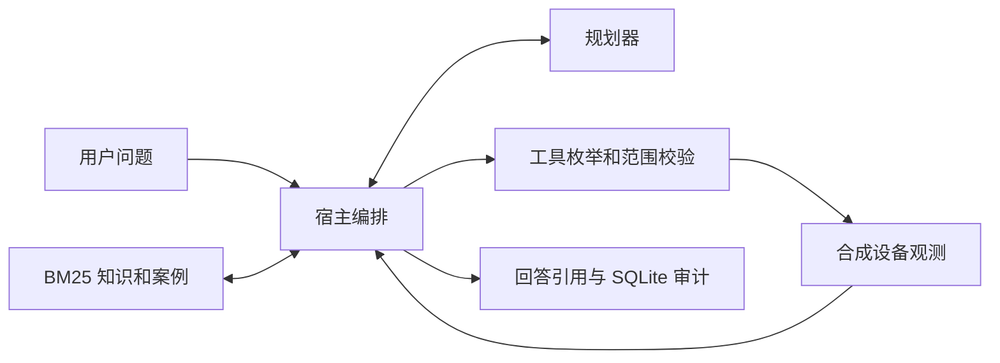

# Agent Troubleshooting Assistant

一个用 Python 标准库实现的网络排障助手。它用 BM25 检索网络机制和历史案例，由宿主校验工具请求，再将服务、接口和路由观测作为回答依据。

此作品集基于 v0.7.0，使用匿名知识资料、虚构设备和合成观测。离线回放以确定性规划器驱动真实宿主循环，覆盖工具选择、证据引用和失败分支。

## 本地复现

需要 Python 3.8 或更新版本。测试和回放无需安装依赖、配置 API Key 或连接设备。

```sh
python -B scripts/check_offline.py
python -B scripts/replay_offline.py --output artifacts/replay.json
```

Windows 上验证了 157 项工程检查，其中 151 项通过、6 项 Linux 专属检查跳过。回放应输出 `scenarios=4`、`engineering_assertions_passed=4`、`model_api_calls=0` 和 `live_device_reads=0`。查看 `artifacts/replay.json` 中的工具顺序、观测、回答和审计记录。重复回放时换一个输出文件名。

运行 `python -B app.py` 可以在浏览器访问 [本地 Web 界面](http://127.0.0.1:17865/)。页面用于预览交互，真实模型对话需要另行配置。合成诊断请运行上面的离线回放。

## 处理流程



| 模块 | 职责 |
| --- | --- |
| [qa.py](qa.py) · [knowledge.py](knowledge.py) | 词法检索、案例匹配与来源索引 |
| [unified_chat.py](unified_chat.py) | 处理结构化工具请求，限制检索和读取次数，编排诊断与回答 |
| [device_tools.py](device_tools.py) | 检查设备和操作是否在登记范围内。回放复用校验，观测由夹具提供 |
| [diagnostic_core.py](diagnostic_core.py) · [evidence_scope.py](evidence_scope.py) | 保存 SQLite 审计，区分历史材料、合成观测和读取失败 |
| [evaluation/remote_replay.py](evaluation/remote_replay.py) | 四个可复现的合成诊断场景 |

## 回放场景

| 场景 | 验证点 |
| --- | --- |
| R01 · 持有 VIP，服务运行 | 继续检查路由，保留端到端业务状态未知 |
| R02 · 持有 VIP，服务停止 | 引用两项观测指出不一致，保留根因待查 |
| R03 · 备机无 VIP，服务停止 | 结合主备分工解释现象，保留接管能力待验收 |
| R04 · 读取超时 | 停止后续读取，报告状态未知 |

这些结果验证的是宿主和工具流程。模型准确率、真实故障定位与端到端业务状态需要独立验收。
